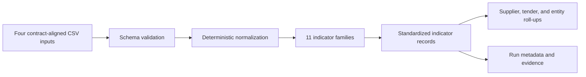

# Governance Risk Assessment System (GRAS)

GRAS is a structured, data-driven analytical framework designed to detect systematic risk patterns across large datasets and generate red flags to support risk-based prioritization. It relies on standardized data and can link and analyze multiple sources. To date, it has been primarily applied to procurement data. In this context, it typically analyzes information on tenders, contracting entities, supplier participation, and award decisions. Rather than examining individual cases, GRAS assesses patterns across large numbers of tenders and applies deterministic red-flag typologies to identify structural risk signals.

GRAS outputs are traceable and standardized, enabling institutions to determine where to focus attention while preserving human judgment, due process, and legal safeguards. GRAS does not make findings of wrongdoing; its purpose is to help institutions decide where to look.

> **Audience:** public-sector integrity, procurement, audit, data, and research teams that want to understand, evaluate, or adapt the GRAS method.

Version `0.1.0rc1` is an unreleased review candidate for an initial `0.1.0`
publication. Installation and examples below work locally; institutional release
approval and the final repository/documentation URLs are not implied.

## Features

- A deterministic Python reference implementation of 11 GRAS indicator families.
- A versioned input/output [data contract](docs/methodology/02_data_contract.md).
- Configurable, validated parameter profiles.
- Supplier-, tender-, and entity-level risk roll-ups.
- Row-level evidence in a stable, machine-readable output schema.
- Run metadata with versions, row counts, file hashes, and timestamps.
- Small synthetic inputs and versioned expected outputs for reproducibility.
- Methodology, typology, pseudocode, architecture, and adaptation guidance.

This repository is a generic reference package. It is not a country's operational deployment, a case-management system, a hosted service, or a distribution channel for procurement data. It contains no production data, credentials, or country-specific configuration.

## How it works



See [Architecture](docs/architecture.md) for the component and data-flow details.

## Getting started

### Prerequisites

- Python 3.10 or later
- Git
- CSV inputs matching the [GRAS data contract](docs/methodology/02_data_contract.md)

No database, external API, cloud account, or secret is required.

### Installation

Download or clone the repository you have been given access to, then open its
root directory (the one containing `pyproject.toml`):

```bash
python3 -m venv .venv
source .venv/bin/activate
python -m pip install --upgrade pip
python -m pip install -e .
```

These activation commands are for macOS/Linux. In Windows PowerShell use
`.venv\Scripts\Activate.ps1` after creating the environment.

### Usage

Run the complete method against the included synthetic dataset:

```bash
gras \
  --tenders examples/synthetic/tenders.csv \
  --bids examples/synthetic/bids.csv \
  --sanctions examples/synthetic/sanctions.csv \
  --employment examples/synthetic/employment.csv \
  --out output/synthetic \
  --profile-name balanced \
  --run-timestamp 2026-01-01T00:00:00Z
```

`--run-timestamp` is optional in normal use. Supplying it makes a run byte-for-byte reproducible against the versioned files in [`examples/synthetic/expected/`](examples/synthetic/expected/).

All four input files require the documented headers. Sanctions and employment
may contain only headers when there are no records; tenders and bids require
data rows. Numeric values use a decimal point, no currency/group separators,
and an optional scientific exponent (`1e3` means `1000`). Invalid nonblank values
stop the run. Blank numeric fields default to zero and should be reviewed upstream.

The command writes:

| File | Purpose |
|---|---|
| `indicator_results.csv` | Standardized indicator-level signals and evidence |
| `supplier_risk_summary.csv` | Cross-indicator supplier roll-up |
| `tender_risk_summary.csv` | Cross-indicator tender roll-up |
| `entity_risk_summary.csv` | Cross-indicator contracting-entity roll-up |
| `run_metadata.json` | Contract, package, profile, input-hash, row-count, and run metadata |

To adapt thresholds without changing the algorithms, copy the baseline [profile file](src/gras/config/parameter_profiles.yaml), give the profile a new name and version, and pass both `--profile /path/to/profiles.yaml` and `--profile-name your_profile`. Follow the [adaptation guide](docs/adaptation-guide.md) before using results in an institutional workflow.

## Documentation

Start with the [documentation home](docs/index.md). The main references are:

- [Method overview](docs/methodology/01_method_overview.md)
- [Data contract](docs/methodology/02_data_contract.md)
- [Indicator catalog](docs/methodology/03_indicator_catalog.md)
- [Parameter profiles](docs/methodology/04_parameter_ranges.md)
- [Execution guide](docs/methodology/06_execution_guide.md)
- [Limitations and governance](docs/methodology/07_limitations_and_governance.md)
- [Architecture](docs/architecture.md)
- [Adaptation guide](docs/adaptation-guide.md)
- [Public-package provenance](docs/provenance.md)
- [GRAS report](https://doi.org/10.1596/40640)

Documentation is available in this repository. A public documentation site and
its final address will be added after the repository destination is confirmed.
See the [changelog](CHANGELOG.md) for methodological changes in this candidate.

## Development and contributing

Install the development tools and run the local quality gates:

```bash
python -m pip install -e '.[dev]'
ruff check .
mypy src/gras
pytest
python -m build
```

The golden-output test reruns the synthetic example and compares every output byte for byte. See [CONTRIBUTING.md](CONTRIBUTING.md), [CODE_OF_CONDUCT.md](CODE_OF_CONDUCT.md), and [SECURITY.md](SECURITY.md) before contributing or reporting a vulnerability.

## Interpretation and responsible use

An indicator is a prioritization signal, not proof of fraud, corruption, collusion, conflict of interest, or any other wrongdoing. Deployments should pair GRAS outputs with documented human review, data-quality checks, local legal and institutional safeguards, proportional access controls, and a process for challenging or correcting data. Do not publish row-level outputs when they may expose personal, confidential, or investigation-sensitive information.

## Contact

- Ariza Atifan Gusti — [agusti@worldbank.org](mailto:agusti@worldbank.org)
- Juan Pablo Guerrero Amparan — [jguerreroampara1@worldbankgroup.org](mailto:jguerreroampara1@worldbankgroup.org)

## Citation

Please use the metadata in [CITATION.cff](CITATION.cff). The associated methodology report is available through the [World Bank Documents & Reports repository](https://documents.worldbank.org/en/publication/documents-reports/documentdetail/099110723040010259).

## License

See [LICENSE](LICENSE) and [WB-IGO-RIDER.md](WB-IGO-RIDER.md).

This project is licensed under the MIT License together with the World Bank IGO Rider.
The Rider is purely procedural: it reserves all privileges and immunities enjoyed by the
World Bank, without adding restrictions to the MIT permissions. Please review both files
before using, distributing or contributing.
