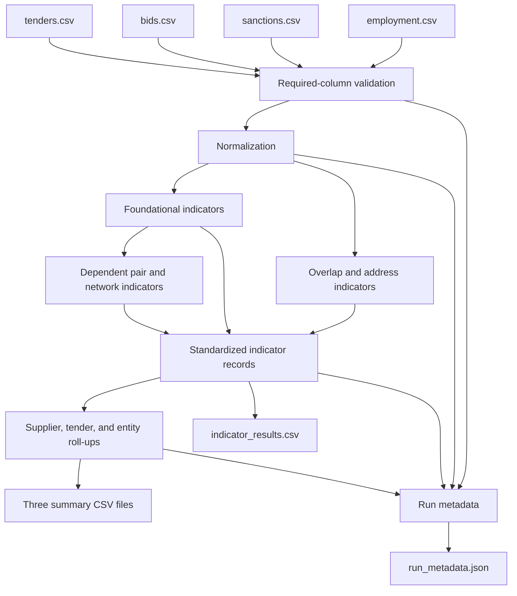

# Architecture and Data Flow

## Scope

The public package is a small, offline Python application. It reads local CSV files, computes deterministic indicator records, and writes local CSV and JSON outputs. It has no database, web interface, network call, authentication layer, scheduler, or deployment-specific integration.

## Data flow

## Components

| Component | Location | Responsibility |
|---|---|---|
| Data contract | `src/gras/data_contract.py` | Required input columns, output schemas, and contract version |
| Normalization | `src/gras/common/normalization.py` | Deterministic parsing, canonicalization, profile loading, and record construction |
| Profiles | `src/gras/config/parameter_profiles.yaml` | Named, versioned indicator thresholds |
| Typologies | `src/gras/typologies/` | One detector per analytical family |
| Roll-up | `src/gras/aggregations/risk_rollup.py` | Cross-indicator supplier, tender, and entity summaries |
| Orchestration | `src/gras/pipeline/run_all.py` | Dependency ordering, file I/O, output generation, and metadata |
| Tests | `tests/` | Unit, characterization, determinism, and golden-output verification |
| Synthetic example | `examples/synthetic/` | Non-production inputs and expected outputs |

## Indicator dependency order

The orchestrator runs foundational indicators before dependent ones:

1. single-bidder concentration and top-loser behavior;
2. top-loser/winner links, using the top-loser result set;
3. co-award pairs and association rules, where the latter uses detected pairs;
4. group patterns and directional conditional influence;
5. event-centric suspicious networks, using earlier top-loser context;
6. sanction, public-employee, and repeated-address overlaps; and
7. supplier, tender, and entity roll-ups.

## Reproducibility boundary

For the same normalized input row multisets, profile, package version, and supplied run timestamp, the four analytical CSV outputs are deterministic, including when input rows are reordered. The pipeline sorts normalized rows before calculation and sorts group evidence references. `run_metadata.json` records input file names, raw row counts, SHA-256 hashes, output row counts, and the contract, package, and profile versions. Reordering a raw file intentionally changes its hash, so metadata is byte-identical only when the raw files and timestamp are identical. The metadata does not copy the input data.

If `--run-timestamp` is omitted, the current UTC time is recorded, so otherwise identical files will differ in their timestamps.

## Security and privacy boundary

The code does not transmit input or output data. Operational adopters remain responsible for storage security, access controls, retention, privacy assessment, and any disclosure restrictions. Synthetic examples are the only data intentionally versioned in this repository.
